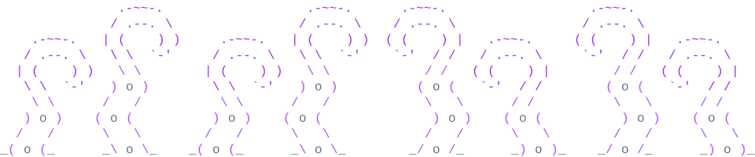
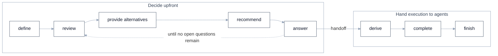

<p align="center">
  <a href="https://github.com/uHappyLogic/gurita/releases/latest">
    
  </a>
  <a href="https://github.com/uHappyLogic/gurita/actions/workflows/drift-gate.yml?query=branch%3Amain">
    
  </a>
  <a href="LICENSE">
    
  </a>
</p>

<div align="center">

| repository | unique views | unique clones |
| --- | --- | --- |
| [uHappyLogic/gurita](https://github.com/uHappyLogic/gurita) | [](https://github.com/uHappyLogic/gurita/tree/traffic-data) | [](https://github.com/uHappyLogic/gurita/tree/traffic-data) |
| [uHappyLogic/gurita-claude](https://github.com/uHappyLogic/gurita-claude) | [](https://github.com/uHappyLogic/gurita-claude/tree/traffic-data) | [](https://github.com/uHappyLogic/gurita-claude/tree/traffic-data) |
| [uHappyLogic/gurita-antigravity](https://github.com/uHappyLogic/gurita-antigravity) | [](https://github.com/uHappyLogic/gurita-antigravity/tree/traffic-data) | [](https://github.com/uHappyLogic/gurita-antigravity/tree/traffic-data) |
| [uHappyLogic/gurita-codex](https://github.com/uHappyLogic/gurita-codex) | [](https://github.com/uHappyLogic/gurita-codex/tree/traffic-data) | [](https://github.com/uHappyLogic/gurita-codex/tree/traffic-data) |

</div>

---

# Gurita

**Decide first, then let the arms carry the work.**
Gurita (Indonesian for octopus) brings all the important questions up to be decided upfront, so you can hand long-running execution to your agent confidently.

Gurita was published as Cairn up to 1.9.0; the old names no longer work, and the upgrade steps for an existing install are under [Installation](#installation).



## Installation

Gurita has two runtime prerequisites: **git**, with your project root inside a git work tree that every skill commits into, and a **Python 3.9 or later** interpreter that answers as `python3` on your PATH. The skills drive the plugin's stdlib-only Python tools with it (no packages to install), and `/define-mission-goal` checks both each time it defines a mission, git first, stopping with the remedy before anything is written when either is missing.

### Claude Code

```
/plugin marketplace add uHappyLogic/gurita-claude
/plugin install gurita@gurita
```

**Upgrading from Cairn?** In a terminal, uninstall `cairn@cairn` at every scope it was installed at, then remove the `cairn` marketplace. The first line below uninstalls it at user scope; where it was also installed at project or local scope, run that line again from the project's root with `--scope project` or `--scope local` before the last line:

```
claude plugin uninstall cairn@cairn --scope user
claude plugin marketplace remove cairn
```

### Antigravity

Extract the latest release into `~/.gemini/config/plugins/gurita`, the global path Antigravity loads the plugin from in every project:

```bash
mkdir -p ~/.gemini/config/plugins/gurita
curl -sL https://github.com/uHappyLogic/gurita-antigravity/archive/refs/heads/main.tar.gz | tar -xz --strip-components=1 -C ~/.gemini/config/plugins/gurita
```

Antigravity discovers a new plugin directory only on startup, so restart any running `agy` session after the extract.

**Upgrading from Cairn?** Delete the old global copy and, from the root of any project you extracted Cairn into under an earlier release, its project-level copy too, since Antigravity discovers that one beside the global copy; then restart any running `agy` session:

```bash
rm -rf ~/.gemini/config/plugins/cairn
rm -rf .agents/plugins/cairn
```

### Codex

Gurita supports the Codex command-line tool. In a terminal, add the `gurita-codex` marketplace and install the plugin from it:

```
codex plugin marketplace add uHappyLogic/gurita-codex
codex plugin add gurita@gurita
```

**Upgrading from Cairn?** In a terminal, remove the `cairn@cairn` plugin and then the `cairn` marketplace:

```
codex plugin remove cairn@cairn
codex plugin marketplace remove cairn
```

In a Codex session, invoke a skill by its name under the plugin's namespace, such as `$gurita:init-mission-base-workflow`. The skills' own text names other skills in the slash form, such as `/derive-tasks`; those slash names refer to the same skills, which you invoke as `$gurita:derive-tasks`.

Codex reads its project instructions from `AGENTS.md`, so on Codex the skills read your project's environment context from `AGENTS.md`, and the bootstrap writes its workflow section there, never to `CLAUDE.md`.

Run your sessions under Codex's workspace-write sandbox with the on-request approval policy; Gurita needs no change to `config.toml`. That sandbox keeps your project's `.git` directory read-only, so every git staging or commit step a skill takes asks for your approval. The plugin's `python3` tools need only read access to the installed plugin directory.

### Bootstrap your project

Then, in your project root, add the mission workflow guidance to `CLAUDE.md` (`AGENTS.md` on Antigravity and Codex) once:

```
/init-mission-base-workflow
```

Run `/init` to document your project — its domain context, working conventions, available tools, and how work is verified as done — in `CLAUDE.md`, so the skills can read that environment context.

## Why Gurita?

Handing long-running execution to an agent breaks down in a predictable way. An agent left to run for a long time hits questions nobody decided, and it either guesses quietly and builds on the guess or stops and waits for a person. Either way, you cannot walk away.

Gurita works mission by mission, and the mission is what makes the handoff possible. Each mission first brings its open questions up, has them answered with recorded decisions, and only then derives tasks an agent can complete unattended. Bringing up all the important questions is the principle Gurita is built toward, not yet a measured result, and later missions of Gurita's own development work toward it.

This holds for any kind of work. Skills read your project's environment — its domain context, working conventions, available tools, and how work is verified as done — from `CLAUDE.md`, so the same sequence fits whatever you're producing.

## Design principles

- **[Gurita finds the open questions before the work starts.](docs/design-claims.md#1-gurita-finds-the-open-questions-before-the-work-starts)** The review skill reads the mission's requirements and writes each gap as an open question, and task derivation does not start while one remains, so the questions reach you before an agent starts building.
- **[Unattended batch runs are possible.](docs/design-claims.md#14-unattended-batch-runs-are-possible)** The batch skills recommend, answer, and complete every item in one run, strictly in sequence — you start them and read the git log afterwards.
- **[Each decision has a record in git.](docs/design-claims.md#2-each-decision-has-a-record-in-git)** One answer is one path-scoped commit whose subject marks how it was made — manual, recommendation, or alternative — so the log is provenance and a revert reopens the question.

All nineteen claims, each with its design and a metric to test it, are in [docs/design-claims.md](docs/design-claims.md).

## How it works

Each mission lives in `<scope>/mission_<slug>/`, directly in the directory holding the core of its work with no container between them (`mission_<slug>/` when that is the project root), and contains three files:

- `requirements.md` — goal, relevant starting state, decisions, and out of scope, as prose Markdown
- `open_questions.xml` — the open questions, one `<open-question>` block each under a single `<open-questions>` root; created empty with the mission and written only by the plugin's open-question tool, never by hand — the mission's requirements have converged when no block remains
- `TASKS_TODO.md` — pending tasks ordered by priority (highest first); created with the mission and written only by the plugin's task-list tool, never by hand, which removes each task once it is completed

A completed task's record is its own `Task-completion: <task heading>` commit rather than a file: the commit's diff holds the task's brief as the section removed from `TASKS_TODO.md`, and its body the acceptance bar the completer derived and verified the work against, one `- ` bullet per criterion. The plugin's read-only missions tool lists a mission's completed tasks, each with its bar, from those commits; since it reads the git log, a shallow clone lists only the task commits its truncated history still holds.

No mission is current. Every skill that works inside a mission is given its path, `--mission <path>`, exactly as `/define-mission-goal` printed it, so it is never ambiguous which mission a run works on, and several missions can stand live at once. `/finish-mission` removes a finished mission's directory in one `Mission-finish: <path>` commit whose body is the mission's summary, so the directories standing are the live missions and the git log holds the finished ones, which the missions tool reads back.

How the skills move a mission through those files is described in [docs/workflow.md](docs/workflow.md), what each skill does is in [docs/skill-reference.md](docs/skill-reference.md), and how to chain the skills as headless command lines, mixing hosts, models, and effort levels, is in [docs/ways-of-using.md](docs/ways-of-using.md).

## Self-dogfooding

This repository runs its own workflow on itself. Its root holds the live missions Gurita's own skills produced, each a `mission_<slug>/` directory with its requirements, open questions, and task list right there in the repo, and the git log holds every finished one: `python3 core/tools/missions.py record .` prints the project's whole record, each mission with its summary and the tasks that built it, and `git show` on a recent `Task-completion:` commit shows one task's change with its verified bar as the body. If you want to see what a real mission looks like end-to-end, look no further.

## Contributing

Gurita is authored once under `core/` and every `hosts/<host>/` tree is rebuilt from it, never hand-edited — see [CONTRIBUTING.md](CONTRIBUTING.md) for the full contributor path, from proposal to pull request.

- Bug reports and proposals — file them through the [issue forms](https://github.com/uHappyLogic/gurita/issues/new/choose).
- Questions — ask in [Discussions](https://github.com/uHappyLogic/gurita/discussions/new?category=q-a).
- Vulnerabilities — report them privately as [SECURITY.md](SECURITY.md) describes, never in an issue.
- Release notes — every release's notes, verbatim, in [CHANGELOG.md](CHANGELOG.md).

## License

MIT — see [LICENSE](LICENSE).
