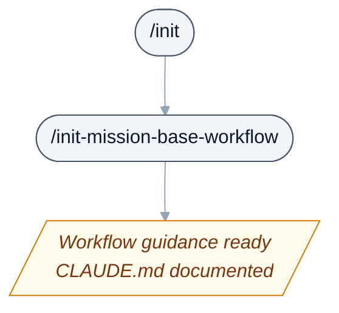
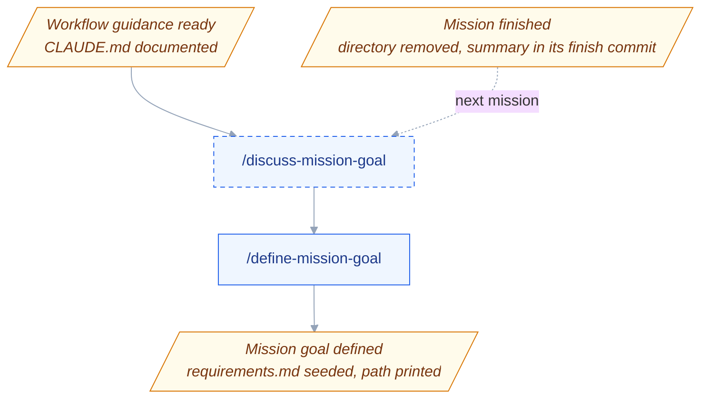
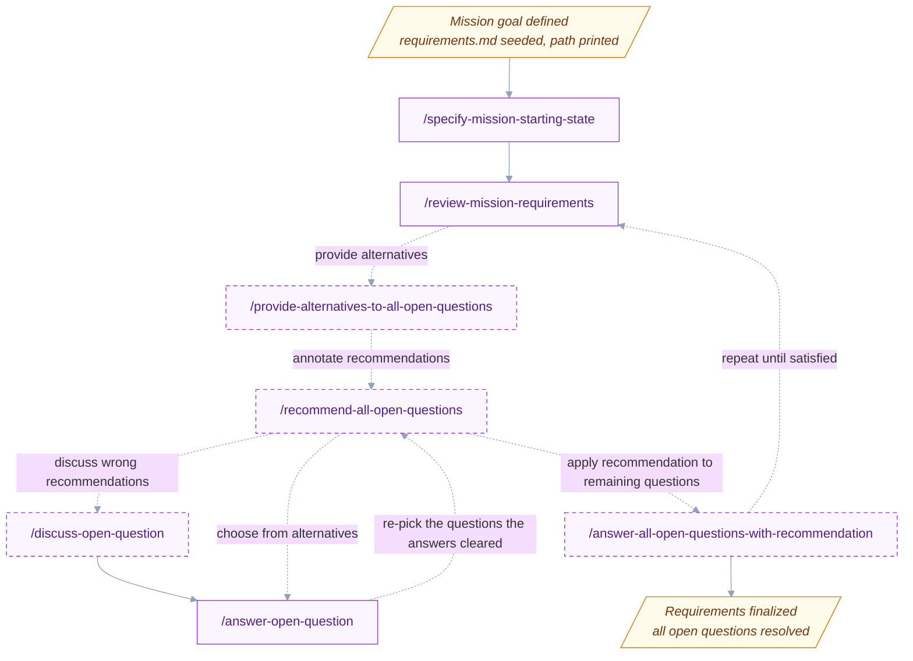
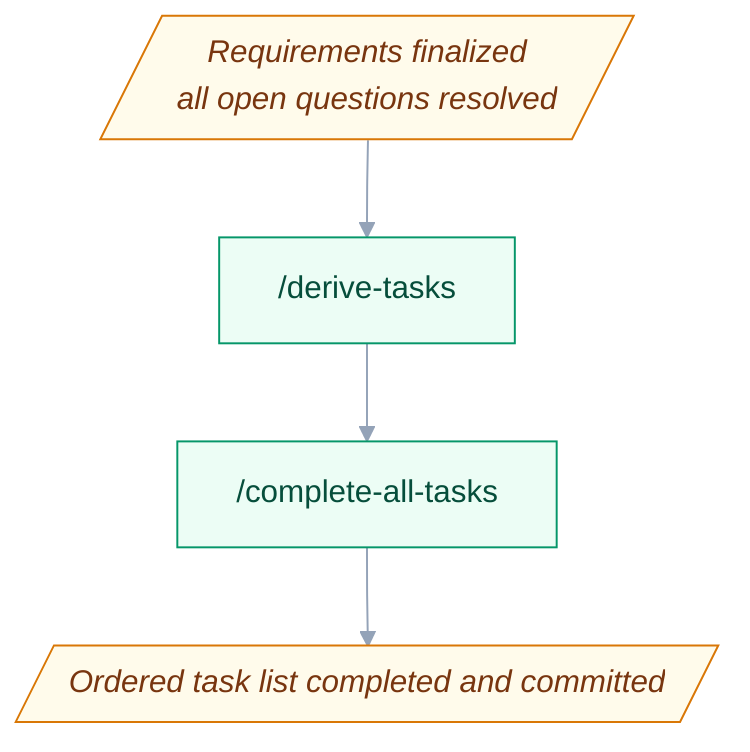
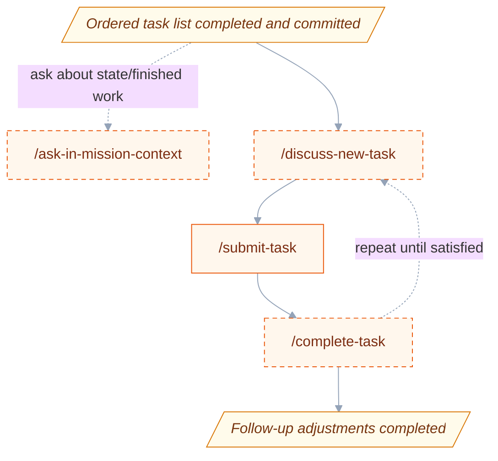
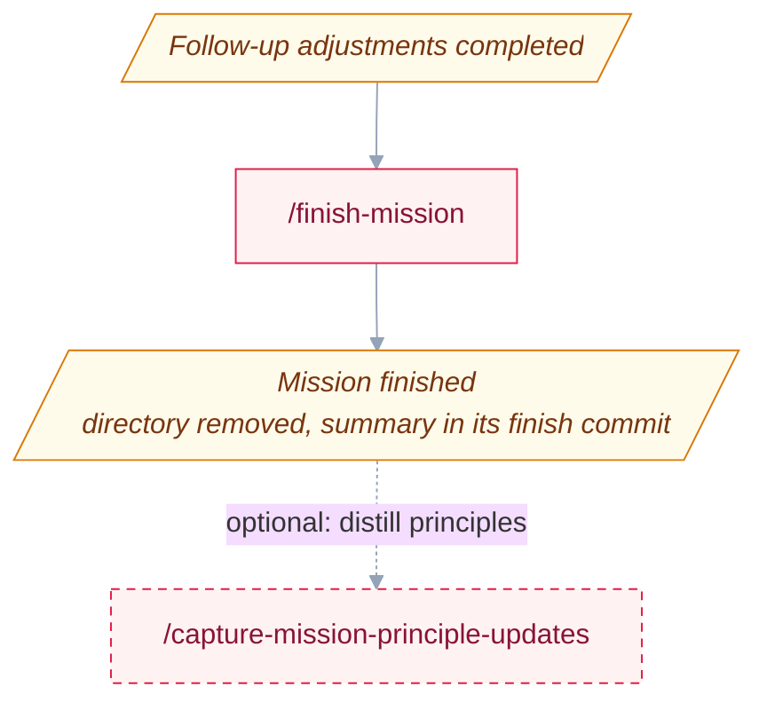

# Workflow

How a mission moves through Gurita's skills: the six phases of the pipeline, how the skills commit what they change, and how the project learns from every answered question. What each individual skill does is in the [skill reference](skill-reference.md), and how to chain the skills as headless command lines is in [ways of using Gurita](ways-of-using.md). Below, the *context file* is the project's `CLAUDE.md` on Claude Code and its `AGENTS.md` on Antigravity and Codex.

## Workflow pipeline

The workflow runs as a stack of six phases. Each phase is its own diagram below, and the amber parallelogram **state** nodes (`D0`–`D5`) are the seams: every phase ends on the state node that the next phase begins with, so the shared node repeats at each boundary and the whole sequence reads top-to-bottom. Node labels are bare skill names. Dashed nodes and edges are optional or repeated steps.

A mission lives in its own directory, `<scope>/mission_<slug>/`, holding three files: `requirements.md` (the goal, the relevant starting state, the recorded decisions, and what is out of scope), `open_questions.xml` (the questions still to decide; empty means converged), and `TASKS_TODO.md` (the tasks still to do). No mission is current: every skill working inside one takes its path as a required leading `--mission <path>`, exactly as `/define-mission-goal` printed it, trailing slash included, so several missions can stand live at once. A call that names no mission, or a path that matches none, stops with the live missions listed beneath it.

### One-time setup

Run once per project, before any mission work. `/init` records the project's domain context, working conventions, available tools, and how work is verified as done in the context file, which the skills read whenever they need to know the project's environment. `/init-mission-base-workflow` then adds the `## Mission Workflow` section to that file, telling anyone working in the project where missions live and how each is named and finished, and commits it under `Workflow-bootstrap: missions`, together with any uncommitted changes `/init` just made to the file. It creates no mission and checks no prerequisites; `/define-mission-goal` does that each time it runs.

To upgrade a project an earlier copy of the plugin (Cairn) set up, go in this order: finish every live milestone with the copy of the plugin it was started under, since Gurita neither finds a milestone directory nor reads a `Milestone-finish:` commit; remove that old copy, as the README's [installation section](../README.md#installation) describes for each host; install Gurita; then run `/init-mission-base-workflow` once more. That run replaces the older `## Milestone Workflow` section whole and moves the principle store from `milestones/answer_decision_principles.md` to the project root in the same commit. What the old copy left behind, its `milestones/README.md` and its numbered milestone directories, is read by nothing and may be removed by hand.

### Initializing a mission

From a documented project, or looping back from a just-finished mission (the dashed **next mission** entry from `D5`), shape and define a mission. `/discuss-mission-goal` optionally sharpens a vague idea and proposes the mission's placement, its **scope**: the one directory holding the core of the work, as deep in the tree as the core allows, and the root `.` only when the core is the project itself. Work the mission also needs elsewhere does not widen the scope, because a mission placed higher overlaps every mission beneath it, and overlapping missions execute one at a time.

`/define-mission-goal --at <scope> <goal>` first checks that the project is a git work tree and that `python3` is Python 3.9 or later, stopping with the remedy when either is missing. It then chooses the mission's title, creates `<scope>/mission_<slug>/` directly in the scope with its three files, the goal filled in, and commits it under `Mission-definition: <path>`, printing the path every later skill takes as its `--mission <path>`. Nothing further readies the mission: work on it can start at once.

### Iterating mission requirements

Drive the mission's requirements to convergence: every important question decided before any task is written.

**Starting state.** `/specify-mission-starting-state` fills the `## Relevant starting state` section of `requirements.md` with the facts the mission's decisions will rest on: what its scope holds now, the adjacent material the goal reaches, the earlier missions whose record bears on it, and what the other live missions in overlapping scopes are deciding or doing. Run later, it refreshes the section in place when the ground has moved since it was last recorded, changing only what no longer holds and adding what is new, and clears every standing recommendation the changed facts undermine; when nothing has moved, it explores nothing and says the starting state is current. You rarely need that re-run by hand, because `/derive-tasks` and `/submit-task` refresh the section themselves when other missions' work has made it stale.

**Review.** `/review-mission-requirements` is the loop's engine. Each pass reconciles the open questions with what is decided, surfaces new gaps as new open questions, each asking one choice, turns every contradiction between recorded decisions into a question naming both entries, and reports the questions still open, ending on `Requirements converged — ready for task derivation.` once none remains. Run it after the starting state and again after every answer or two, since answers open new questions. It never answers a question.

**Deciding by hand.** `/discuss-open-question` talks one question through with you, with alternatives, a recommendation, and what would change its mind, and offers `/answer-open-question` to record what you decide, word for word, with your rationale in the commit body. When a discussion shows that the goal itself must change, it offers `/modify-mission-goal`, which revises `## Goal` and clears the recommendations the new goal undermines; loop back through review afterwards.

**Annotating in batch.** Two optional passes do for every question at once what a discussion does for one, split at the seam between listing options and picking one. `/provide-alternatives-to-all-open-questions` gives every question that has none yet a set of alternatives, distinct from one another and together covering the decision, not doing the thing included where that is viable, one subagent per question. A set, once written, is never changed by a later pass, so the options you read are the options that are picked from. `/recommend-all-open-questions` then picks one alternative per question, weighing the whole set at once so the picks agree with one another, with a one-line rationale, the principles that bore on it, and the sibling outcomes it assumed, and puts the questions in the order the answer sweep will record them.

**Recording.** `/answer-open-question-with-recommendation` records one question's recommendation as its answer, `/answer-open-question-with-alternative` records the alternative you name by its id instead, and `/answer-all-open-questions-with-recommendation`, the answer sweep, records every standing recommendation unattended, in dependency order, so a pick is recorded only after the sibling picks it assumed. However an answer is recorded, the decision is written into `## Decisions` first and the question is removed after, and every other question whose recommendation assumed a different outcome of this one has its pick cleared, keeping its alternatives, so an override costs only a re-run of the recommendation pass. When a single-question answer contradicts a recorded decision it plainly replaces, that entry is rewritten in place; when it only arguably does, the pair is noted under `## Noted contradictions`, a section that stands only while a note does, for the next review pass to ask about. A conflict question, one asking which of two decisions stands, is answered by rewriting the losing entry. The answer sweep judges nothing: it records every pick as given and leaves contradictions and moot entries to the next review pass.

The order this gives is: hand answers first, each its own run, then one re-run of `/recommend-all-open-questions`, which picks again for exactly the questions those answers cleared, then the answer sweep for the rest. So reading the annotated set and recording your own answers is one sitting between the first recommendation pass and its re-run. A wrong recorded answer is corrected by reverting its commit, which reopens the question, and answering again. Repeat until no open question remains; a contradiction note still standing never blocks `/derive-tasks`.

### Automated one-shot task derivation and completion

Hands-off execution. `/derive-tasks` turns the converged `requirements.md` into an ordered `TASKS_TODO.md` of brief-level tasks, each a title and one to three sentences on what is to be achieved, why, and how it would be verified, and writes the whole list in one commit. Where two recorded decisions cannot both hold, the one recorded later governs. `/complete-all-tasks` then works through the list top to bottom, one fresh subagent per task: each derives the task's acceptance bar from its brief and the mission's decisions, does the work, verifies it against that bar, and removes the task from the list, and the run commits each task on its own. The run stops at the first task that fails or cannot be committed, keeping every earlier task committed and the failed task's partial work in the tree, for a later run to resume.

**The scope gate.** A mission is **started** once tasks were ever entered into its list, and a started mission holds its scope until `/finish-mission` removes its directory. While another started mission's scope is the same directory as this one's, one enclosing it, or one beneath it, task entry and task completion stop with that mission's path listed. Defining and preparing a mission never waits on the gate, so you can decide a second mission's questions while the first one runs; missions in disjoint scopes execute at the same time. The gate reads the git history, so it refuses to open in a shallow clone; fetch the full history first (`git fetch --unshallow`).

**A refreshed starting state.** A mission that waited at the gate meets ground the holder changed. When other missions' work has landed in the scope since the starting state was recorded, `/derive-tasks` and `/submit-task` refresh the section themselves before they write, as a `Starting-state:` commit of their own, and derive against the refreshed facts and the decisions as recorded. Every chain on the [ways of using Gurita](ways-of-using.md) page that derives and completes tasks also opens with the starting-state line and one review pass, so the decisions are weighed against the refreshed facts before tasks are written.

**Past work.** Before changing an existing file that the mission's `requirements.md` does not explain, a completing runner may read the completed tasks that changed it and the decisions behind them. Where an earlier mission chose something on purpose that the task as briefed would undo, the runner meets the brief in a way that keeps it wherever such a way exists. A completed task's whole record is its `Task-completion:` commit: the subject carries its title, the diff its brief as the section removed from `TASKS_TODO.md`, and the body the acceptance bar the work was verified against.

### Semi-manual follow-up and adjustments

Inline, conversational adjustments after the automated pass. `/ask-in-mission-context` answers read-only questions about the mission at any time, finished work and earlier missions included. `/discuss-new-task` clarifies an issue found mid-flight into one or more task briefs and hands them to `/submit-task`, which adds one clear task to the list, at the end or before or after a task you name, checking the scope gate and refreshing a stale starting state as `/derive-tasks` does. `/complete-task` completes a single task inline, exactly as a `/complete-all-tasks` subagent would, with the conversation kept for follow-up tweaks. Repeat until satisfied.

### Ending a mission

Close out. `/finish-mission` checks that no open question and no task remains, composes a short summary of the mission from its goal, decisions, and completed tasks, updates the context file only for lasting changes to how the project is worked on, and removes the mission's directory in one `Mission-finish: <path>` commit whose body is the mission's title and that summary. A mission is finished exactly when its directory is gone: its files stand in the commit before the finish, later skills read its summary back from the finish commit, and reverting that commit makes the mission live again. `/capture-mission-principle-updates <path>` is the optional principle harvester described [below](#the-answer-principle-learning-loop); finish is its natural moment, since the mission's answers are complete by then, but it is never run by finish and runs on a live mission too. From `D5` the loop returns to **Initializing a mission** for the next one.

## How skills commit

You never stage anything by hand. **Every skill that changes files ends by committing exactly those files**, and only them: whatever else your working tree or index holds, your own uncommitted edits or another run's work included, stays out of the commit. Each commit's subject opens with a marker naming what the skill did:

| Subject | Made by |
|---|---|
| `Workflow-bootstrap: missions` | `/init-mission-base-workflow` |
| `Mission-definition: <path>` | `/define-mission-goal` |
| `Starting-state: <path>` | `/specify-mission-starting-state`, and `/derive-tasks` or `/submit-task` when they refresh a stale starting state |
| `Requirements-review: <path>` | `/review-mission-requirements` |
| `Alternatives-annotation: <Short Title>` | `/provide-alternatives-to-all-open-questions`, one per question |
| `Recommendation-annotation: <path>` | `/recommend-all-open-questions`, the picks of a run together |
| `Question-ordering: <path>` | `/recommend-all-open-questions`, only when the new order moved a question |
| `Manual-answer: <Short Title>` | `/answer-open-question` |
| `Alternative-answer: <Short Title>` | `/answer-open-question-with-alternative` |
| `Recommendation-answer: <Short Title>` | `/answer-open-question-with-recommendation`, and the answer sweep, one per answer |
| `Goal-revision: <path>` | `/modify-mission-goal` |
| `Task-derivation: <path>` | `/derive-tasks` |
| `Task-submission: <task title>` | `/submit-task` |
| `Task-completion: <task heading>` | `/complete-all-tasks`, one per task, and `/complete-task` |
| `Mission-finish: <path>` | `/finish-mission` |
| `Principle-capture: <path>` | `/capture-mission-principle-updates` |

A subject that names a mission names it by its path, trailing slash included, so two missions that share a slug in different scopes never share a subject. One unit of work is one commit: each answer, each annotated question, and each completed task lands on its own, so reverting one commit undoes exactly that unit, and reverting an answer reopens its question. A completed task's commit carries its verified acceptance bar as the body, a finish commit the mission's summary, and an answer commit the rationale behind the answer, or the chosen alternative's text. A run that changes nothing commits nothing rather than making an empty commit. The conversational skills, `/discuss-mission-goal`, `/discuss-open-question`, `/discuss-new-task`, and `/ask-in-mission-context`, change no files and never commit.

The git log is the project's record of finished work: completed tasks and finished missions are read back from their commits, not from files. Read it in a full clone when the whole of it matters, since a shallow clone holds only part of the history.

The three answer subjects also tell answers apart by where they came from. `/capture-mission-principle-updates` reads `Manual-answer:` and `Alternative-answer:` as answers you chose over the recommendation, the signal it learns new principles from, and `Recommendation-answer:` as an accepted recommendation, evidence about the principles already stored and never the source of a new one.

## The answer-principle-learning loop

Open questions get resolved through deliberation, and the project *learns* from every answer that overrides a recommendation. Confirmed answering principles accumulate in `answer_decision_principles.md`, a single project-wide store at the project **root**, above any one mission, so principles carry across missions. Each is a short keep-or-eliminate rule that the recommendations read as advice.

- **Teaching flow.** Deliberate a question with `/discuss-open-question` and record your answer with `/answer-open-question`, or pick a different embedded option with `/answer-open-question-with-alternative`. The rule behind your answer is not generalized on the spot: `/capture-mission-principle-updates <path>`, which you run for a named mission whenever you like, naturally right after finishing it, distils it later. It walks the mission's answers and sets each against the recommendation and principles you saw at the time. Answers that overrode the recommendation are what it learns from, and where one carries no reason of yours it asks why you preferred your option, offering its own best guess, with a choice to accept or skip every guess at once so a backfill over a mission you no longer remember stays quick; accepted recommendations only reinforce or flag the principles already stored. It then rewrites the store as a whole, adding, revising, merging, generalizing, or pruning entries, and leaves the rewrite in place for you to review with `git diff`. One confirmation commits it; declining restores the store as it was.
- **Recommendation advice.** A confirmed principle that bears on a question is a strong default in favour of the option it supports, in `/discuss-open-question` and `/recommend-all-open-questions` alike: merit may override it only for a reason stated in the recommendation, and it never rules an option out. Whenever a principle steered a pick, the recommendation cites it beside the pick, never inside the text an answer records, so the decision written into `requirements.md` carries no citation. Principles advise recommendations; they never answer a question themselves.
- **Correction loop.** There is no dedicated correction skill. To correct a wrong recorded answer, revert its commit, which reopens the question, and record it again. A principle that steered a recommendation wrong is reconciled the next time `/capture-mission-principle-updates` runs for that mission: your corrective answer is an override of a recommendation that cited the principle, so the capture narrows, generalizes, replaces, or prunes it in the rewrite you review. For a principle that is plainly wrong now, edit the plain-Markdown store by hand; the next capture tells you it found uncommitted edits and, once you go on, builds its rewrite over them.
