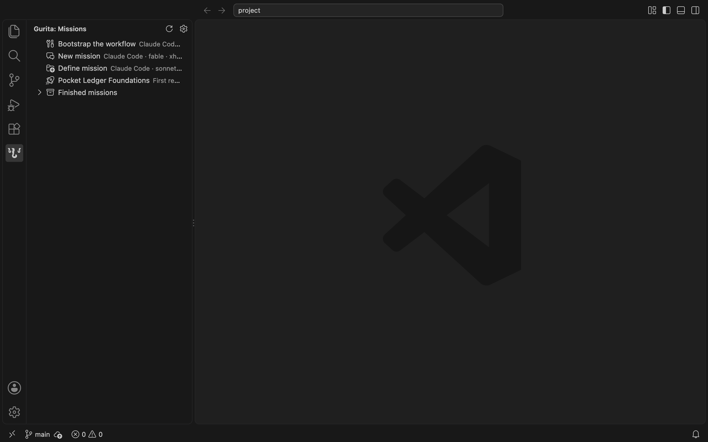
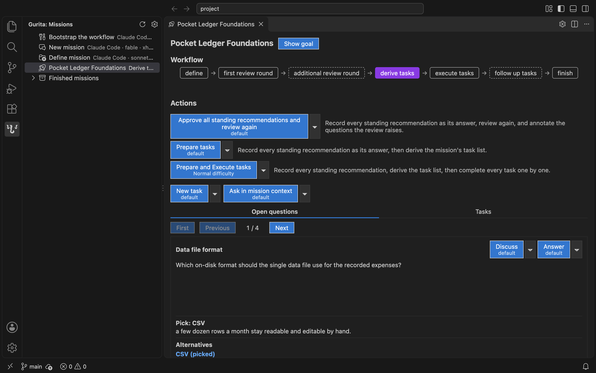
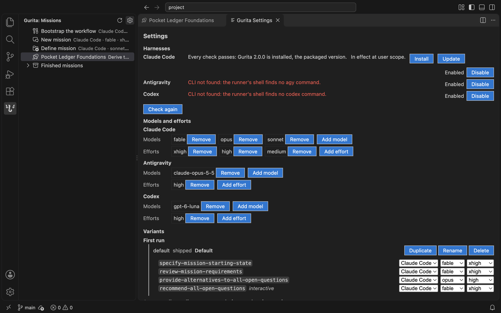
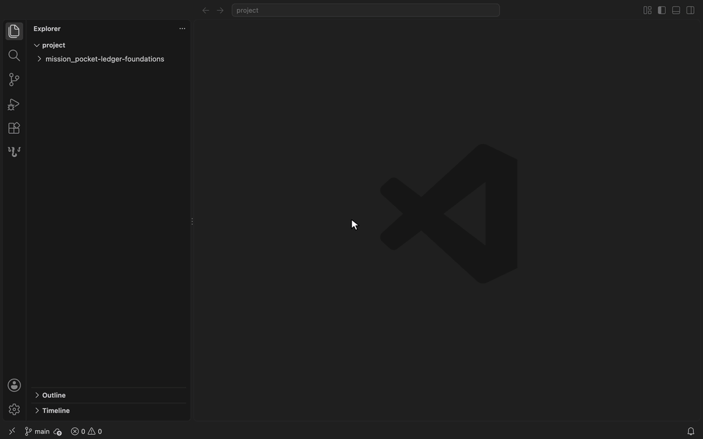

# Gurita for VS Code

Gurita for VS Code (`gurita-vscode`) puts the Gurita plugin's live missions in a side-bar view
behind its own activity-bar entry and in a window per mission in the editor area: each mission's page with its question view and remaining tasks, buttons that
run the plugin's skills as recipes in a terminal, and a looped task run that completes a
mission's tasks one at a time. It drives the `claude` and `agy` command-line tools with the
Gurita plugin installed in them; it does not replace the plugin.

## The side-bar view



The **Missions** view, behind the Gurita entry in the activity bar, is where you start: it lists
every live mission with its next workflow step and its counts of open questions and remaining
tasks, starts a new mission from **New mission** or **Define mission**, offers the workflow
bootstrap while the project lacks it, and keeps the finished missions one row away.

## A mission page



A click on a mission's row opens its page, where the work on that mission is done: the workflow
diagram fills the step to run next, the actions that fit that step run their recipes in a
terminal with one click, and the question view walks the open questions one card at a time, each
with its pick, its alternatives, and the buttons that discuss or answer it, beside the mission's
remaining and completed tasks.

## The Settings window



The Settings window, behind the gear in the view's title bar, is where you set up how runs are
made: it checks that each harness has the Gurita plugin installed and up to date and installs or
updates it, enables or disables each harness, keeps each harness's models and efforts, and lets
you duplicate, rename, and re-point every variant of every recipe onto another harness, model, or
effort.

## See it run



The extension runs only on macOS, Linux, or through Remote-WSL. On native Windows it shows one
message saying so and leaves its view, windows, and runner inert; in a Remote-WSL window it runs
on the Linux side and works as it does on Linux.

Everything the extension does, view by view and window by window, is documented in
[USAGE.md](https://github.com/uHappyLogic/gurita/blob/main/gurita-vscode/USAGE.md). To build the
extension from a checkout of the Gurita repository instead, see
[BUILDING.md](https://github.com/uHappyLogic/gurita/blob/main/gurita-vscode/BUILDING.md).

## What the extension needs

- VS Code 1.107.0 or later, or an editor built on VS Code 1.107.0 or later.
- `python3`, 3.9 or later, on `PATH`: the extension runs the bundled missions tool and its own
  runner with it. No Node install is needed.
- `git`: the project root is the top level of a git work tree.
- `claude` and, for the `agy` lines, `agy`, each with the Gurita plugin installed, on the
  `PATH` of the shell the runner starts. The Settings window can install or update the plugin
  for you (see
  [Installing and updating the plugin](https://github.com/uHappyLogic/gurita/blob/main/gurita-vscode/USAGE.md#installing-and-updating-the-plugin)
  in USAGE.md).
- macOS or Linux. On Windows only through Remote-WSL, where the extension runs on the Linux side.

## Installing

Install the extension from the Extensions view by searching for **Gurita for VS Code**, or from
the command line:

```
code --install-extension BusyMinds.gurita-vscode
```

The installed extension's id is `BusyMinds.gurita-vscode`, and its version is the extension's
own, independent of the Gurita plugin's. To remove it, run
`code --uninstall-extension BusyMinds.gurita-vscode`.
